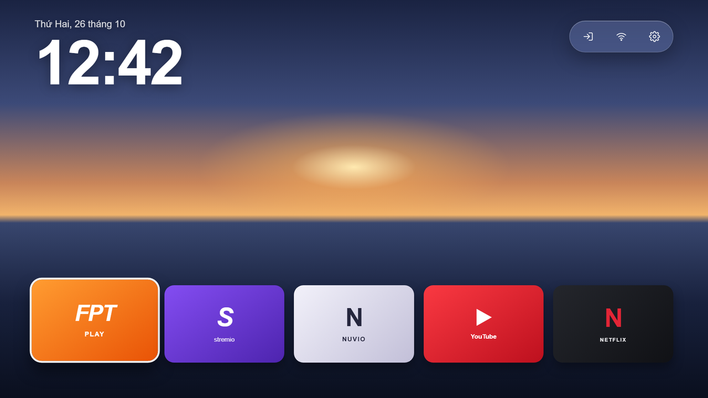
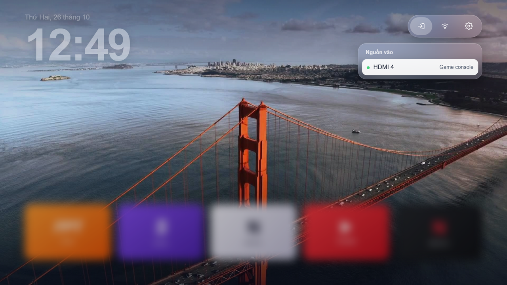
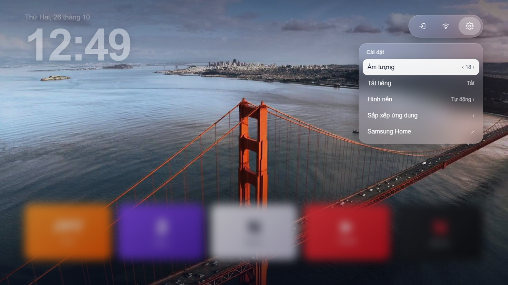

# CleanYourTizen

[English](README.md) · [Tiếng Việt](README.vi.md)

A glass-style, Apple TV-inspired **home screen app for Samsung Tizen TVs**, plus a careful, read-only-by-default
toolkit to inspect a TV and plan app cleanup. It runs as a normal app: no root, no firmware changes, and Samsung Home and
Art Mode stay untouched.



| Input menu | Settings |
|---|---|
|  |  |

*Screenshot wallpaper: an Apple TV aerial image, used for illustration only. It belongs to its owners and is not covered by this project's MIT license. The repository ships no wallpapers; use images you may use.*

## Highlights

- Big clock and date, a time-of-day greeting, the Vietnamese lunar date and a one-line countdown to the next 2-3 holidays or family days.
- A quick-access pill for **Input**, **Wi-Fi** and **Settings**, and a row of your favourite apps.
- **Input switching** with the device names your TV reports (for example a game console on HDMI 4).
- **Wi-Fi** name and signal, **volume and mute**, and an app arrangement screen.
- **Daily wallpaper** from your own images, with a quick picker that previews each one live.
- Optional background service that brings the launcher back when Home is pressed, while leaving Art Mode, standby and running apps alone.
- Everything is local HTML/CSS/JS. No network calls, no accounts, no analytics.
- Safe cleanup tooling: inspect, plan, apply with a plan hash and data-loss acknowledgement, and verify.

## Start here

- **[Step-by-step guide (English)](docs/GETTING-STARTED.md)** · **[Hướng dẫn từng bước (Tiếng Việt)](docs/HUONG-DAN.md)**
- [Signing and certificates](docs/SIGNING.md) · [Safety scope](docs/SAFETY.md) · [Device acceptance checklist](docs/ACCEPTANCE.md)

Inspired by the inspect → review → apply → verify workflow of
[CleanYourTV](https://github.com/Gathin23/cleanyourtv). This is an independent implementation;
Android `adb`, `pm disable-user` and APK launchers do not run on Tizen.
Not affiliated with Samsung or Apple. App names are their owners' trademarks; tile graphics are original typography.

> **Use at your own risk.** Uninstalling an app deletes its data and logins and cannot be undone from this tool.
> The launcher cannot take over the Home key, Power key or brand hotkeys. Everything here was verified on one TV
> (see below); other models and firmware may behave differently.

## What works, and what is not promised

| Feature | v0.1 |
|---|---|
| Read model, capabilities and app inventory | Official SDB and local TV info endpoint |
| Preview selected app removal | Offline plan; no default deletion set |
| Uninstall reviewed user-facing packages | Explicit plan hash, data-loss acknowledgement, per-package verification |
| Restore removed app data | **Not possible from an inventory.** Manual store reinstall only |
| Standalone launcher | Tizen 6.5+ target, local HTML/CSS/JS. Glass home with clock, greeting, lunar date and countdown, Wi-Fi, input and settings pill, volume/mute, daily or chosen wallpaper, ordered shortcuts, Samsung Home escape |
| Signed launcher installation | Requires your own Samsung certificates and signed WGT |
| Replace physical Home / Power / brand hotkeys | **Not possible for a normal app.** They are absent from the TV's supported keys; see [the device profile](profiles/qa55ls03b.json) |
| Return to launcher when Home covers it | Opt-in background web service (`service.mode: guard`); see below |
| Keep Art Mode | No Power/Home key interception; guard skips Art Mode and standby; verified on QA55LS03B only |
| Every Samsung TV | **Not claimed.** Tizen only, capability-driven, exact-device evidence |

Current device evidence is in [profiles/qa55ls03b.json](profiles/qa55ls03b.json).
An inventory result is not evidence that uninstall, signatures, remote keys or startup work.
Orsay TVs and commercial/hospitality displays are not covered by the initial profile.

## What was verified on a real TV

Evidence for one Vietnamese The Frame (QA55LS03BAKXXV, Tizen 6.5), recorded in [profiles/qa55ls03b.json](profiles/qa55ls03b.json):

- A launcher signed with your own Samsung author and distributor certificates installs with `tizen install` and opens apps.
- Input switching works: `tizen.tvwindow.setSource` with the instances returned by `systeminfo` `VIDEOSOURCE`,
  shown through a transparent page. The TV supplies device names (for example a console or soundbar).
- Wi-Fi name and signal come from `systeminfo` `WIFI_NETWORK`; volume and mute from `tizen.tvaudiocontrol`.
- **Not possible from a web app on this TV:** opening Samsung's Settings, Network and Home Setting apps (`UnknownError`),
  changing picture or sleep-timer settings, taking over Home, Power or the brand hotkeys,
  and removing preinstalled apps (`can not uninstall app`, also with `vd_appuninstall`).

Other models and firmware may differ. Treat these as observations, not guarantees.

## Requirements

- Python 3.10+ (standard library only), official Samsung/Tizen `sdb` on PATH or `--sdb /path/to/sdb`.
- TV and computer on a trusted LAN, TV Developer Mode enabled for the computer IP.
- Node 18+ for preview and JavaScript tests; no npm dependencies or install needed.
- To install the launcher: the official Tizen command-line tools (`sdb`, `tizen`) with Samsung's Certificate and TV extensions,
  and your own Samsung author/distributor certificates. The Tizen Studio IDE itself is not needed; see the
  [step-by-step guide](docs/GETTING-STARTED.md).

Use Samsung's [device connection instructions](https://developer.samsung.com/smarttv/develop/getting-started/using-sdk/tv-device.html).
The repo does not download or redistribute Samsung binaries, signing keys or firmware.

## Inspect and plan (no TV changes)

Run at the repo root. `python` may be `python3` on Linux/macOS.

```sh
python -m cyt inspect --host 192.168.1.50 --firmware EXACT-FIRMWARE --out .local/before.json
python -m cyt plan --snapshot .local/before.json --remove HJCS8hkoCO --keep ZTpEFWgfa9 NuvioTV001 IkWsFHtOY9 --out .local/plan.json
```

The numeric IDs above are **examples, not a recommended deletion list**. Read the snapshot, choose
your own installed packages, check Samsung Apps in your region for reinstall availability, and
review every app/service belonging to each selected package. Unknown IDs and unexpected members
are blocked by [catalog/apps.json](catalog/apps.json). A package prefix shape alone is not proof
that an app is removable or safe.

The `firmware` field is explicitly owner-supplied when the network API cannot report it.
The fingerprint binds the plan to the TV, but this does not magically grant shell/root access.
SDB capabilities are observations, not promises that every supported-looking command works.

## Apply only after review

**Tizen uninstall is destructive.** It removes selected app data, including logins. A snapshot is
an inventory, not a binary/account backup. Store reinstall can be unavailable and cannot restore
login state. Retain paid activation information separately. Do not uninstall irreplaceable apps.

```sh
python -m cyt apply --snapshot .local/before.json --plan .local/plan.json --confirm FULL_HASH_PRINTED_IN_PLAN --allow-data-loss --journal .local/cleanup-journal.json
python -m cyt recovery --journal .local/cleanup-journal.json
python -m cyt verify --journal .local/cleanup-journal.json
```

`apply` checks the catalog, complete plan, TV fingerprint, capabilities and original app inventory.
It records intent **before** each uninstall, runs one package at a time, then checks that exactly the
expected App IDs disappeared and no unrelated app changed. An `ok` response alone never counts.
Any failure or drift stops the run; the journal remains. Existing snapshots/journals are never replaced.
There is no blind automatic retry or automatic factory reset. See [SAFETY](docs/SAFETY.md).
`verify` can be repeated after a user-controlled reboot; it checks exact app inventory, not playback or physical Art Mode.

## Launcher preview, build and install

```sh
npm run preview
# Open http://127.0.0.1:4173 and use arrows, Enter, Escape.
python -m cyt launcher-config --snapshot .local/before.json --apps ZTpEFWgfa9.FPTPlay IkWsFHtOY9.Stremio NuvioTV001.NuvioTV --out .local/launcher.json
python -m cyt build --config .local/launcher.json --out dist/launcher-v1 --wallpapers .local/wallpapers
```

Optional private settings in `.local/launcher.json`:

- `"inputs": [{"type": "HDMI", "number": 4}]` lists the only inputs shown in the input menu. The TV supplies their names.
- `"greetingName": "nhà An Bình"` adds a name to the time-of-day greeting.
- `"events": [{"name": "Sinh nhật Bi", "month": 10, "day": 29}, {"name": "Giỗ ông", "month": 9, "day": 20, "lunar": true}]`
  adds private days to the countdown line, which shows the nearest 2-3 events (Vietnamese and international days built in)
  next to the Vietnamese lunar date.
- `--wallpapers DIR` bundles up to 60 `jpg`/`png` files (at most 2.5 MB each, 1920x1080 recommended).
  One is shown per local day, in file-name order; Settings → Hình nền previews and saves a fixed choice.

The build creates a staging directory and a deterministic **unsigned** WGT for inspection.
It is deliberately refused by `cyt install`. Sign the staging directory with Samsung's official
tools first: [certificate and signing guide](docs/SIGNING.md). Then install the signed widget with the
official `tizen install`; `cyt install` also works but only reports success when the app appears in the TV inventory.

```sh
python -m cyt install --snapshot .local/before.json --config .local/launcher.json --widget .local/signed/launcher.wgt
python -m cyt launch --snapshot .local/before.json --config .local/launcher.json
python -m cyt home-status
```

`tools/probe/` is a small on-device API probe (read-only except buttons you press). Build and sign it like the
launcher with its own package ID, and remove it afterwards.

Use a unique, stable 10-character alphanumeric package ID (`launcher-config --package`) and keep
the same author certificate for updates. Default `CyTizen001` is a development identity, not a
Samsung-approved production identity. Distribution to other owners requires their signing workflow.
The launcher is opened as a normal app. Physical Home continues to open Samsung Home
(the opt-in guard service then reopens the launcher; see below).
Return/Escape opens the verified stock Home app, or exits the launcher when its identity is unknown.
No API calls change Art Mode, Home routing, system power or startup settings; the service only reads them.

## Background service (return to launcher)

Every build packages `<package>.Service` (a Tizen web service, Node.js on the TV). Add to the private
launcher JSON:

```json
"service": {"mode": "guard", "delayMs": 500}
```

The default `observe` mode never launches anything. In `guard` mode the launcher page tells the service
when it is hidden; after `delayMs` (default 2.5 s, minimum 0.3 s) the service reads the TV's own REST API
on `127.0.0.1:8001`, running app contexts and `/sys/fs/cgroup/cpu/running` (the CPU cgroup in which
the TV keeps what is on screen), then reopens the launcher unless the TV is not `on`, Art Mode is running,
the launcher is visible again, or a media app is in front (for example YouTube cast from a phone).
Apps opened from the launcher are followed while they run: when Samsung Home enters `cpu/running`
(Home pressed inside the app), the launcher returns after the same delay. **Samsung Home ↗** and Back
pause the service for `pauseMs` (10 min). A cooldown blocks loops. `reportUrl` (private LAN HTTP only)
sends diagnostic events to a computer; leave it out for normal use.

Known limits on QA55LS03B / Tizen 6.5: `addAppStatusChangeListener` never fires and the REST `visible`
flag is wrong for most apps, hence the cgroup signal; `/proc` of other apps is not readable;
`on-boot` services are unavailable on consumer TVs (use *Autorun Last App*).

## Test and contribute

```sh
python -m unittest discover -s tests -v
npm test
```

Python tests cover wrong TV, inventory drift, missing consent, plan tampering, protected packages,
service membership, incomplete/collateral uninstall, connection failure and durable recovery records.
Node tests cover D-pad boundaries, stored order and failed launches. See [device acceptance](docs/ACCEPTANCE.md)
for the separate physical test checklist. Browser success does not establish on-TV compatibility.

New profiles must record exact model/firmware, command evidence and unknowns. Never submit tokens,
IP/MAC/DUID, credentials, certificates or screenshots of private content. Keep them in `.local/` or
`output/`, both excluded from Git. See [CONTRIBUTING](CONTRIBUTING.md).

## Research references

- [Samsung CLI](https://developer.samsung.com/smarttv/develop/getting-started/using-sdk/command-line-interface.html)
- [Samsung Application API](https://developer.samsung.com/smarttv/develop/api-references/tizen-web-device-api-references/application-api.html)
- [Community debloat findings](https://github.com/ardazeytin/samsung-tizen-tv-debloat): model-specific, no universal uninstall guarantee.
- [Arn0 native Home research](https://github.com/NelsonEU/arn0-tv/blob/main/docs/setup-tv.md): undocumented, exact-firmware guards, not enabled here.
- [CleanFrame experiment](https://github.com/nthnclrk/CleanFrame/blob/main/docs/agent-tv-setup-guide.md): The Frame Art Mode and startup need physical verification.

MIT licensed. No upstream implementation code is vendored.
